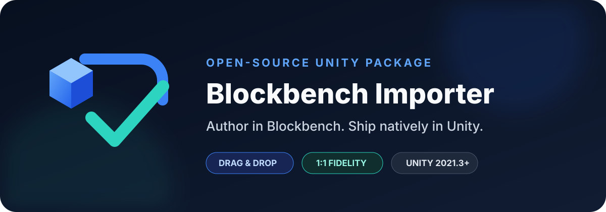
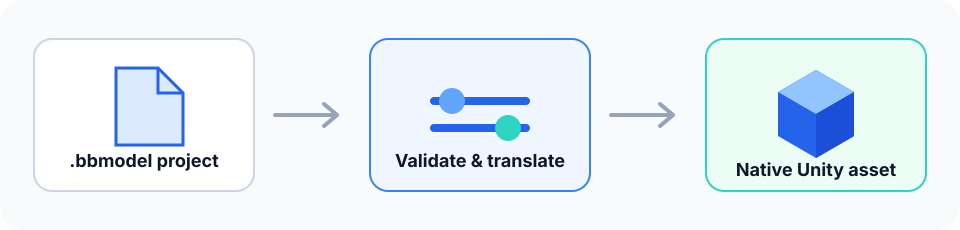

<div align="center">
  
</div>

<div align="center">

[](https://github.com/martincalander/UnityBlockbenchImporter/actions/workflows/validate.yml)
[](https://github.com/martincalander/UnityBlockbenchImporter/actions/workflows/codeql.yml)
[](https://github.com/martincalander/UnityBlockbenchImporter/releases/latest)
[](https://unity.com/releases/editor/whats-new/2021.3.0)
[](package.json)
[](LICENSE.md)

**Drag in a `.bbmodel`. Get a native Unity asset.**

[Install](#installation) · [Import guide](Documentation~/importing-models.md) · [Format support](Documentation~/format-support.md) · [Contribute](CONTRIBUTING.md) · [Report a bug](https://github.com/martincalander/UnityBlockbenchImporter/issues/new/choose)

</div>

Unity Blockbench Importer is a Scripted Importer for Blockbench project files. Put a `.bbmodel` anywhere under `Assets/`; Unity imports its hierarchy, geometry, textures, materials, animations, and optional Animator Controller as one self-contained, prefab-like asset.

The translation layer is designed for fidelity: Blockbench's absolute pivots, coordinate system, outliner, face UVs, texture assignments, armatures, and additive animation channels are converted deliberately instead of approximated through an intermediate export format.

## Why this importer

| | Capability | What you get |
|---|---|---|
| 📦 | Native drag-and-drop | `.bbmodel` files behave like first-class Unity assets and reimport when edited. |
| 🎯 | Transform fidelity | Shared-space pivots, nested groups, handedness conversion, element origins, and rotations are preserved. |
| 🧊 | Production geometry | Cubes, polygon meshes, weighted armatures, billboards, locators, nulls, and bounding boxes are translated. |
| 🎨 | Texture-aware materials | Embedded and external textures, per-face assignments, UV rotation, alpha cutout, and double-sided modes are supported. |
| 🎬 | Animation-ready | Clips and an optional Animator Controller are generated directly from Blockbench animation channels. |
| 🔒 | Non-destructive | Source files are never rewritten, scripts are never evaluated, and generated data stays inside the imported asset. |

<div align="center">
  
</div>

## Installation

### Unity Package Manager

1. Open **Window → Package Manager**.
2. Select **+ → Add package from git URL…**.
3. Enter:

   ```text
   https://github.com/martincalander/UnityBlockbenchImporter.git
   ```

To pin a release, append a tag such as `#v1.0.0`. You can also add the dependency directly to `Packages/manifest.json`:

```json
{
  "dependencies": {
    "com.essentials.blockbenchimporter": "https://github.com/martincalander/UnityBlockbenchImporter.git#v1.0.0"
  }
}
```

The package supports Unity `2021.3` or newer. Install from a tagged release for reproducible projects; use `main` only when evaluating unreleased changes.

## Three-step workflow

1. Save your Blockbench project as `.bbmodel` and keep any non-embedded textures beside it.
2. Drag the file into the Unity Project window.
3. Select the imported asset to configure scale, visibility, materials, textures, animations, and collider behavior; press **Apply** to reimport.

The main asset can be dragged directly into a scene. Meshes, textures, materials, clips, and the optional controller remain embedded sub-assets, so the Project window stays tidy.

## Import settings

- **Units Per Pixel** defaults to `0.0625`, matching Blockbench's default 16-pixels-per-unit glTF scale.
- **Include Hidden / Non-Exported Elements** controls whether authoring-only content is generated.
- **Material Mode** defaults to Unlit for viewport-like color; Lit integrates with scene lighting.
- **Texture Filter / Wrap** defaults to Point and Clamp for pixel-art fidelity.
- **Alpha Mode** detects transparency or forces opaque/cutout rendering.
- **Import Animations** creates clips; **Create Animator Controller** adds an Animator and one state per clip.

See the [import guide](Documentation~/importing-models.md) for the complete workflow and [format support matrix](Documentation~/format-support.md) for exact behavior and known boundaries.

## Compatibility and trust

- The package is editor-only except for the small runtime billboard component required by imported camera-facing geometry.
- Imported JSON is treated as data. Plugin-defined Molang expressions are not executed.
- Unknown element types are preserved as transforms and surfaced as warnings rather than silently dropped.
- Pull requests receive package-structure, metadata, documentation, dependency, and CodeQL checks.
- Releases are built from version tags and include a SHA-256 checksum.

No importer can promise visual identity for every custom Blockbench plugin or shader pipeline. Unsupported data is documented in the [format support matrix](Documentation~/format-support.md), and fidelity bugs are treated as defects.

## Documentation

- [UPM manual](Documentation~/index.md)
- [Installation and upgrades](Documentation~/installation.md)
- [Importing models](Documentation~/importing-models.md)
- [Format support](Documentation~/format-support.md)
- [Troubleshooting](Documentation~/troubleshooting.md)
- [Architecture and safety model](Documentation~/architecture.md)
- [Contributing](CONTRIBUTING.md), [support](SUPPORT.md), and [security policy](SECURITY.md)

## Contributing

Issues and focused pull requests are welcome. Please read [CONTRIBUTING.md](CONTRIBUTING.md) before changing the translation layer; every fidelity fix should include the smallest legal `.bbmodel` fixture or a programmatic regression test that demonstrates the expected Blockbench-to-Unity mapping.

## License and attribution

Licensed under the [Apache License 2.0](LICENSE.md). Copyright © 2026 Martin Calander. Derivative distributions must retain applicable attribution notices from [NOTICE.md](NOTICE.md) as described by Section 4(d) of the license.

Unity is a trademark of Unity Technologies. Blockbench is a trademark of its respective owner. This independent project is not affiliated with, endorsed by, or sponsored by Unity Technologies or Blockbench.

<div align="center">
  <sub>Designed and maintained by <a href="https://martincalander.com">Martin Calander</a>.</sub>
</div>
